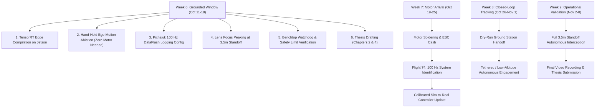

# Strategic Action Plan: Weeks 6 to 9
**Bachelor Thesis — Danmarks Tekniske Universitet (DTU)**  
**Project:** Autonomous Drone Pursuit & Vision-Based Interception on Jetson Orin Nano + Pixhawk  
**Author:** Philip Kierkegaard  
**Date:** October 11, 2026  
**Target Milestone:** Fully operational autonomous pursuit drone by the end of Week 9  

---

## Executive Summary & Situation Analysis

### Current Status
* **Hardware Blocker:** One brushless propulsion motor failed during bench testing. Replacement motor delivery window: **October 17 – October 24, 2026** (7 to 13 days of zero flight operations).
* **Perception Stack:** Fine-tuned YOLOv8n ($768\times 768$) with 15% negative background integration achieved **96.7% mAP@50** and 99.7% precision on local drone data (`yolov8n_nougat_pede_768_best.pt`), with edge TensorRT latency validated at **26.0 ms (38.3 FPS)**.
* **State Estimation:** 8D Kalman filter upgraded with instantaneous $SO(3)$ attitude decoupling and $\mathbb{R}^3$ translation parallax feedforward. Dual-filter ablation logging infrastructure (`--ego-ablation-log`) is fully implemented.
* **Control & Dynamics:** Flight 73 revealed slow vertical climb dynamics ($\tau_z = 800\text{ ms}$), but 9.7 Hz live telemetry under-sampled fast roll/pitch dynamics ($\tau < 50\text{ ms}$), proving the necessity of $\ge 100\text{ Hz}$ onboard DataFlash logging.

### The Guiding Strategy: Zero Flight Downtime Waste
The greatest risk to achieving a working autonomous drone by Week 9 is treating the motor delay as idle waiting time. If hardware calibration, high-rate logging setup, TensorRT edge compilation, camera focus, and safety limits are deferred until the motor arrives, field testing will be plagued by avoidable software bugs.

By executing all non-flight deliverables during **Week 6 (Grounded Window)**, the moment the replacement motor is soldered on in Week 7, the drone transitions immediately into live flight validation without software troubleshooting delays.

---

## Prioritized Action Areas (Ranked by Impact)



---

### Priority 1: Compile TensorRT Engine & Validate Edge Ingestion on Jetson
* **Rationale:** The newly fine-tuned model (`yolov8n_nougat_pede_768_best.pt`, 96.7% mAP) currently resides on your Mac as PyTorch weights. On the Jetson Orin Nano, running raw PyTorch yields only 8–12 FPS; it must run as an FP16 TensorRT `.engine` to achieve 38+ FPS.
* **Actionable Steps:**
  1. Transfer model to Jetson:
     ```bash
     scp perception/weights/yolov8n_nougat_pede_768_best.pt philip@192.168.55.1:/home/philip/Development/autonomous-drone-tracking/perception/weights/
     ```
  2. Compile on the Jetson Orin Nano:
     ```bash
     yolo export model=perception/weights/yolov8n_nougat_pede_768_best.pt format=engine imgsz=768 half=True device=0
     ```
  3. Validate sustained hardware framerate with CSI ingestion and adaptive shadows:
     ```bash
     python3 run_tracker.py --csi --weights perception/weights/yolov8n_nougat_pede_768_best.engine --adaptive-shadows --dry-run
     ```
* **Success Criteria:** Sustained end-to-end throughput $\ge 35\text{ FPS}$ with $<28\text{ ms}$ latency per frame under MAXN power mode.

---

### Priority 2: Execute Hand-Held Kinematic Ego-Motion Ablation Test
* **Rationale:** You do **not** need functional motors to validate your state observer. The Pixhawk IMU streams live attitude at 50 Hz, and the Sony IMX477 camera streams live video. Validating attitude decoupling now secures your quantitative results and publication figure for Chapter 4 before flight operations commence.
* **Actionable Steps:**
  1. Place target drone stationary on ground or terrace table at $3.0\text{--}3.5\text{ m}$.
  2. Run tracker with dual-filter ablation logging:
     ```bash
     python3 run_tracker.py --csi --weights perception/weights/yolov8n_nougat_pede_768_best.pt --ego-ablation-log --adaptive-shadows --dry-run
     ```
  3. Execute 45-second motion protocol:
     * $0\text{--}15\text{ s}$ (Pure Rotation): Rock roll/pitch $\pm 20^\circ$ with feet planted.
     * $15\text{--}30\text{ s}$ (Pure Translation): Hold level, sidestep walk $5\text{ m}$ sideways at $\sim 1.2\text{ m/s}$.
     * $30\text{--}45\text{ s}$ (Coupled Motion): Natural hand movement simulating 6-DOF flight.
  4. Press `Ctrl+C` to generate the benchmark table and 300 DPI plot (`outputs/ablation/ego_motion_ablation_*.png`).
* **Success Criteria:** Quantified $>85\%$ reduction in velocity estimation RMSE during dynamic maneuvers compared to vanilla Kalman filtering.

---

### Priority 3: Configure Pixhawk $\ge 100\text{ Hz}$ Onboard DataFlash Logging
* **Rationale:** Flight 73 revealed that 9.7 Hz MAVLink telemetry under-samples pitch and roll dynamics ($\tau < 50\text{ ms}$). To identify true airframe time constants for the controller, the Pixhawk must write high-speed logs directly to its internal micro-SD card. Setting this up on the bench guarantees that the very first flight after motor repair produces publication-quality system identification data.
* **Actionable Steps:**
  1. Connect to Pixhawk via Mission Planner / QGroundControl / MAVProxy:
     * Set `LOG_BITMASK = 65535` (or enable `IMU_FAST`, `ATTITUDE_FAST`, `RCIN`, `RCOUT`).
     * Set `LOG_DISARMED = 1` for 60 seconds on the bench to verify logging without arming.
  2. Physically rock the drone on your desk for 30 seconds.
  3. Pull the `.BIN` file from the SD card.
  4. Run `control/identify_dynamics.py` to confirm the parser extracts attitude data at $\ge 100\text{ Hz}$ ($\Delta t \le 10\text{ ms}$).
  5. Reset `LOG_DISARMED = 0` prior to outdoor flight to preserve SD card space.
* **Success Criteria:** Verified `.BIN` log containing $>100\text{ Hz}$ attitude/rate samples with no dropped frames.

---

### Priority 4: Lens Focus Peaking Calibration at Target Standoff ($3.5\text{ m}$)
* **Rationale:** At $3.5\text{ meters}$, a small drone occupies only $63\text{ pixels}$. If the manual lens focus ring is slightly soft, edge gradients blur, dropping YOLO detection confidence against complex background vegetation.
* **Actionable Steps:**
  1. Position target drone at measured distance ($3.5\text{ m}$) with a measuring tape.
  2. Launch focus peaking tool:
     ```bash
     python3 scripts/tune_camera_focus.py --csi --stream
     ```
  3. Open `http://192.168.55.1:8080` on your laptop to inspect the live 4x digital loupe.
  4. Manually rotate the C/CS-mount lens focus ring until the high-water sharpness score peaks.
  5. Tighten the lens grub screw to lock focus permanently against motor vibration.
* **Success Criteria:** Maximum edge Laplacian score achieved and lens physically locked.

---

### Priority 5: Benchtop Hardware-in-the-Loop (HITL) Safety & Watchdog Validation
* **Rationale:** Avoid discovering control law instability or flip hazards in the air. Verify all safety clamps, deadband logic, and watchdogs while the drone is on the ground.
* **Actionable Steps:**
  1. Run tracker in dry-run mode:
     ```bash
     python3 run_tracker.py --csi --dry-run
     ```
  2. Verify safety envelopes in code and terminal telemetry:
     * **Deadband Cushion:** Move target between $3.15\text{ m}$ and $3.85\text{ m}$ ($\pm 0.35\text{ m}$ around $3.5\text{ m}$); verify commanded $v_x = 0.0\text{ m/s}$.
     * **Asymmetric Reverse Cap:** Push target inside $2.5\text{ m}$; verify reverse command never exceeds $-0.5\text{ m/s}$.
     * **Slew-Rate Limiter:** Step target quickly; verify acceleration clamp limits commanded rate of change to $\le 4.0\text{ m/s}^2$.
     * **Deadman Watchdog:** Completely cover the camera lens with a book or hand; verify watchdog trips within $0.40\text{ s}$ and commands a level holding hover (`vx=0, vy=0, vz=0`).
* **Success Criteria:** All 4 safety mechanisms trigger cleanly with zero command spikes.

---

### Priority 6: Write Core Chapters of the Bachelor Thesis
* **Rationale:** Writing the thesis under pressure in Week 9 while debugging hardware is stressful. Chapters 2, 3, and 4 are based on research, math, and experiments already completed. Drafting them now frees your mind for flight testing in Weeks 7–9.
* **Target Chapters:**
  * **Chapter 2 (Perception & Domain Adaptation):**
    * Bounding box loss comparison: Normalized Wasserstein Distance (NWD) vs. CIoU.
    * Empirical model scaling ($640^2 \to 768^2$, $+44\%$ pixel density).
    * Negative background mining (+15% negative ratio, false positive elimination).
    * Edge TensorRT FP16 compilation and latency breakdown (38.3 FPS on Jetson).
  * **Chapter 3 (Guidance & Control Architecture):**
    * Kinematic IBVS formulation and virtual image frame projection.
    * Safety envelopes: deadband cushion ($\pm 0.35\text{ m}$), asymmetric reverse saturation ($-0.5\text{ m/s}$), altitude braking cushions.
    * Predictive RL control: Recurrent PPO formulation and 1.1 ms CPU inference.
  * **Chapter 4 (State Estimation & Observers):**
    * 8D Kalman filter formulation.
    * $SO(3)$ rotation homography decoupling vs. $\mathbb{R}^3$ translation parallax.
    * Benchtop kinematic ablation report and 3-panel figure.
* **Success Criteria:** First complete draft of Chapters 2, 3, and 4 completed by October 18.

---

### Priority 7: Pre-Flight Hardware Preparation for Motor Arrival
* **Rationale:** When the package arrives between Oct 17 and Oct 24, reassembly should take under 60 minutes.
* **Preparation Checklist:**
  * Soldering iron, 60/40 or lead-free solder, and flux cleaned and ready.
  * Correct diameter heat shrink tubing pre-cut for motor lead wires.
  * Blue threadlocker (Loctite 243) on hand for motor mount screws.
  * Motor spin direction check: verify whether the broken motor is CW or CCW (prop nut thread direction and ESC wiring).
  * Propeller inspection and dynamic balancing to eliminate camera vibration.

---

## Weekly Master Schedule: Road to Week 9

| Phase / Timeline | Primary Operational Goals | Deliverables / Milestones |
| :--- | :--- | :--- |
| **Week 6**<br>*(Oct 12 – Oct 18)*<br>**Grounded Phase** | 1. Jetson TensorRT compilation (`768^2`)<br>2. Benchtop Ego-Motion Ablation test<br>3. Pixhawk 100 Hz DataFlash logging config<br>4. Optical focus tuning at 3.5m<br>5. Draft Thesis Chapters 2 & 4 | ✓ Publication figure for Chapter 4<br>✓ 38+ FPS edge engine on Jetson<br>✓ 100 Hz logging verified on bench<br>✓ Chapters 2 & 4 drafted |
| **Week 7**<br>*(Oct 19 – Oct 25)*<br>**Hardware Reassembly & Air Trials** | 1. Solder replacement motor & balance props<br>2. Motor direction & bench spin test<br>3. **Flight 74:** Manual flight with 100 Hz DataFlash logging<br>4. Run `identify_dynamics.py` on real 100 Hz data<br>5. Calibrate simulation & PID gains | ✓ Flight-ready propulsion system<br>✓ Ground-truth pitch/roll $\tau$ identified<br>✓ Controller tuned with real dynamics<br>✓ Chapter 3 drafted |
| **Week 8**<br>*(Oct 26 – Nov 1)*<br>**Closed-Loop Autonomous Flight** | 1. **Flight 75:** Tethered / low-altitude dry-run handoff<br>2. **Flight 76:** Classical IBVS tracking against stationary drone<br>3. Tune standoff distance and yaw deadband in flight<br>4. Record annotated flight HUD and pristine raw video | ✓ Stable 3.5m autonomous station-keeping<br>✓ Real flight HUD video footage<br>✓ Chapter 5 (Flight Results) drafted |
| **Week 9**<br>*(Nov 2 – Nov 8)*<br>**Final Interception & Thesis Submission** | 1. **Flight 77:** Dynamic target tracking (target drone moving)<br>2. Benchmark Predictive vs. Geometric controller<br>3. Final data consolidation & thesis polishing<br>4. Project submission and presentation prep | ✓ Complete autonomous pursuit proof<br>✓ Thesis submission ready<br>✓ Video demonstrations archived |

---

## Conclusion: The Path to Success
Your goal of a fully operational autonomous pursuit drone by Week 9 is completely achievable despite the motor breakdown. By front-loading perception compilation, state estimation validation, camera optics, logging infrastructure, and thesis drafting into Week 6, you eliminate every software uncertainty. When the replacement motor arrives, you will have a clear, de-risked runway directly into successful flight trials.
