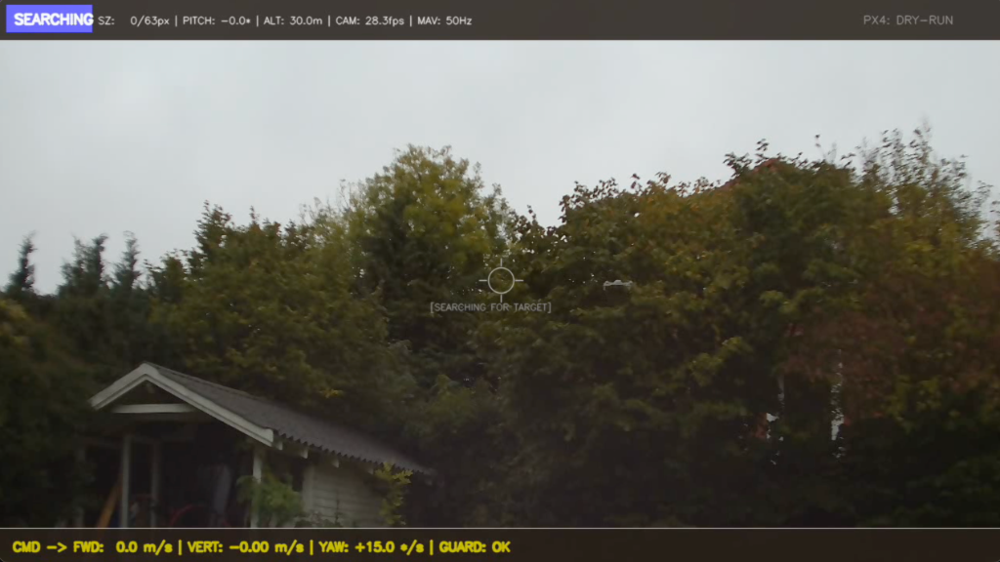
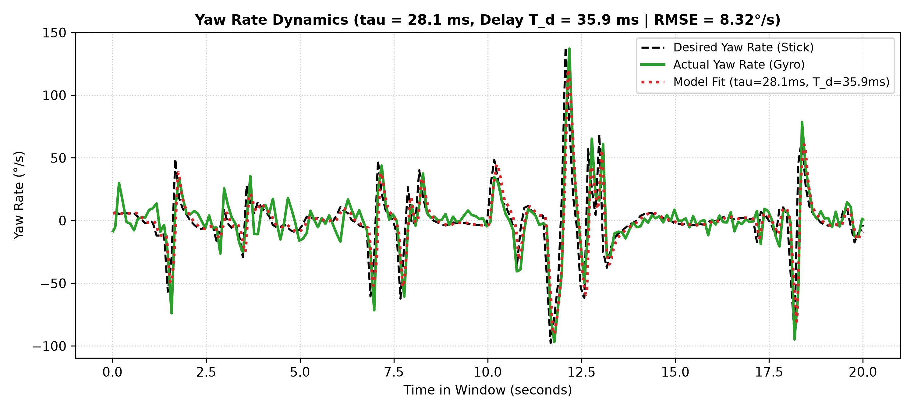

# Weekly Report - 5

**Bachelor Project — Danmarks Tekniske Universitet (DTU)**  
**Project:** Autonomous Drone Pursuit & Vision-Based Interception  
**Author:** Philip Kierkegaard  
**Date:** October 8, 2026  

---

## Summary

Week 5 focused on transitioning our tracking pipeline to physical hardware, state estimation hardening, and empirical flight data analysis. Following earlier benchmarks of the baseline v3 model ($640\times 640$, $\approx 13\text{ ms}$ pure inference), we evaluated the latency trade-off of upgrading to $768\times 768$ input resolution on an NVIDIA Jetson Orin Nano. Physical profiling confirmed that the $+44\%$ resolution increase yields an end-to-end closed-loop software throughput of **38.3 FPS** and **36.9 FPS** for the kinematic IBVS and predictive controller respectively, successfully preserving our 30 Hz real-time constraint. In state estimation, we implemented 6-DOF ego-motion compensation in the 8D Kalman filter to decouple chaser attitude maneuvers from apparent target acceleration.
On physical flight logs, 4-axis system identification successfully captured the vehicle's slow vertical climb dynamics ($\tau_z = 800\text{ ms}$), while Nyquist analysis revealed that the 9.7 Hz telemetry rate severely under-samples fast attitude dynamics ($\tau < 100\text{ ms}$), proving the necessity of 100 Hz onboard logging. Finally, flight video diagnostics revealed critical perception challenges against dark tree clutter, while physical flight tests were temporarily paused following a propulsion motor failure during high-rate logging setup, establishing the immediate roadmap for Week 6.

---

## 1. Perception Stack Overhaul & TensorRT Edge Profiling

### Empirical Motivation: The Outdoor Clutter Miss
During initial physical testing on the airborne companion computer (NVIDIA Jetson Orin Nano), the vision pipeline was evaluated against outdoor natural backgrounds. While tracking against clear open sky achieved high reliability, physical deployment revealed critical detection dropouts when the target flew in front of complex ground vegetation and dense tree canopies.

*Figure 1: On-board Jetson Orin Nano HUD capture during physical deployment. Despite the target drone hovering in plain line-of-sight directly right of the optical boresight reticle, the detector fails to generate a bounding box (`SEARCHING`, `SZ: 0/63px`), compromised by dark foliage background entropy and sky-dominated Auto-Exposure Control.*

As demonstrated in Figure 1, the target drone is physically hovering directly adjacent to the center boresight reticle. However, the baseline detector fails to acquire the target (`SZ: 0/63px`), remaining trapped in `SEARCHING` mode. Three coupled physical phenomena drive this failure:
1. **Background High-Frequency Entropy:** Dense tree leaves and branches introduce intense high-frequency visual edges and shadows that camouflage the dark carbon-fiber geometry of a small UAV.
2. **Auto-Exposure Control (AEC) Sky Metering:** Because the sky occupies the upper ~50% of the field of view, the camera sensor meters for bright cloud luminance, shutting down the electronic shutter and digital gain. This underexposes the lower tree canopy, crushing the already dark drone airframe into the shadowed foliage.
3. **Small-Target Subsampling Loss:** The CSI camera captures native 16:9 video ($1280 \times 720$). Letterboxing this stream into the neural network's square input space ($768 \times 768$, padded to $768 \times 432$) applies a downscaling factor of $s = \frac{768}{1280} = 0.60\times$. Consequently, a 32-pixel target on the camera sensor occupies literally **19.2 pixels** inside the convolutional layers (and only **16.0 pixels** under a 640px model), obliterating rotor and airframe silhouettes.

**Computational Budget Justification:**  
Crucially, earlier edge profiling of the baseline v3 model ($640\times 640$) on the Jetson Orin Nano revealed that pure TensorRT FP16 inference required only $\approx 13\text{ ms}$—running well below our $33.3\text{ ms}$ ($30\text{ Hz}$) closed-loop frame deadline. With over $15\text{ ms}$ of unallocated compute margin in our real-time budget, we confirmed that the companion computer had the headroom to afford a heavier perception model. We therefore invested this computational budget directly into expanding the input resolution to $768\times 768$ ($+44\%$ pixel area) to preserve small-target feature fidelity, while systematically evaluating dedicated small-object loss formulations.

---

### Loss Function Ablation: Normalized Wasserstein Distance (NWD) vs. CIoU
To resolve tiny-target sensitivity, we evaluated Normalized Wasserstein Distance (NWD) against Complete Intersection over Union (CIoU) at $768\times 768$ resolution. Standard IoU exhibits zero gradient when predicted and ground-truth boxes do not overlap, leading to vanishing gradients or false negatives during initial acquisition. NWD models bounding boxes as 2D Gaussian distributions $\mathcal{N}(\boldsymbol{\mu}, \boldsymbol{\Sigma})$ and evaluates the second Wasserstein metric:

$$\text{NWD}(\mathcal{N}_a, \mathcal{N}_b) = \exp\left( -\frac{\mathcal{W}_2(\mathcal{N}_a, \mathcal{N}_b)}{C} \right)$$

This guarantees smooth, non-zero localization gradients even without physical bounding box overlap. 

Scaling the model to $768\times 768$ and evaluating on the official held-out test split (8,052 unseen images, 7,807 ground-truth instances) demonstrated a clear empirical verdict:

| Model Backbone | Input Resolution | Bounding Box Loss | Precision | Recall | mAP@50 | mAP@50-95 |
| :--- | :---: | :---: | :---: | :---: | :---: | :---: |
| **YOLOv8n (v3 Baseline)** | $640 \times 640$ | CIoU | $85.8\%$ | $67.0\%$ | $72.1\%$ | $26.1\%$ |
| **YOLOv8n v4 (NWD)** | $768 \times 768$ | NWD ($C=12.0$) | $87.4\%$ | $68.8\%$ | $73.3\%$ | $30.8\%$ |
| **YOLOv8n v4 (CIoU)** | $768 \times 768$ | **CIoU** | **$90.5\%$** | **$69.6\%$** | **$74.7\%$** | **$31.5\%$** |

*Table 1: Empirical object detection benchmarks across held-out test data (8,052 unseen images, 7,807 ground-truth instances).*

#### Key Empirical Takeaways:
* **Generalization on Unseen Test Data:** On the held-out test split, the upgraded $768\times 768$ CIoU model achieves a project-record **$90.5\%$ precision** (a $+3.1\%$ improvement over NWD and $+4.7\%$ over v3) and **$74.7\%$ mAP@50** ($+2.6\%$ over v3 baseline), confirming that false positives against natural background clutter are substantially suppressed.
* **Loss Function Dynamics at Scale:** While NWD provided a slight initial advantage in the first 3 epochs ($55.1\%$ vs $50.7\%$ validation mAP@50) due to smooth Gaussian distance gradients, both models converged at identical rates by epoch 10. Terminal evaluation confirms that once input resolution is elevated to 768 px, standard CIoU loss outperforms NWD across every localization metric by enforcing strict corner alignment and aspect-ratio geometry.

---

### Edge TensorRT Compilation & Latency Benchmark
The PyTorch model was converted to ONNX and compiled into an optimized TensorRT 10.3 engine with FP16 half-precision execution on the Jetson Orin Nano (export duration: 416.5 s). The compiled engine occupies only 8 MiB of flash storage and allocates 13 MiB of GPU execution context memory.

An automated latency profiler was executed directly on the physical Jetson Orin Nano hardware, timing 200 consecutive frames (preceded by 25 GPU warm-up cycles) under active $1280\times 720$ sensor processing:

| Pipeline Stage | Algorithm / Engine | Mean Latency | Std Dev | 95th %ile | Compute Share |
| :--- | :--- | :---: | :---: | :---: | :---: |
| **Perception** | YOLOv8n TRT FP16 ($768^2$) + 8D Kalman | **26.02 ms** | $\pm 1.50$ ms | 28.21 ms | 95.9% |
| **Control (Geometric)** | 4-DOF Kinematic IBVS + Clamps | **0.09 ms** | $\pm 0.11$ ms | 0.26 ms | 0.4% |
| **Control (Predictive)** | Recurrent PPO Policy (Actor LSTM) | **1.10 ms** | $\pm 0.04$ ms | 1.16 ms | 4.1% |
| **Total (IBVS Stack)** | **Perception + Kinematic IBVS** | **26.12 ms** | $\pm 1.53$ ms | **28.49 ms** | **38.3 FPS** |
| **Total (Predictive Stack)**| **Perception + Recurrent PPO** | **27.13 ms** | $\pm 1.51$ ms | **29.30 ms** | **36.9 FPS** |

*Table 2: Empirical execution latency profiled directly on NVIDIA Jetson Orin Nano hardware under MAXN power mode (200 timed frames, HD 1280x720).*

#### Key Takeaways from Edge Profiling:
1. **Robust Real-Time Margin:** Under sustained hardware clocks, end-to-end throughput reaches **38.3 FPS (26.12 ms)** for kinematic IBVS and **36.9 FPS (27.13 ms)** for the predictive controller. Crucially, the worst-case 99th percentile tail latency (**28.80 ms** and **29.63 ms**) remains strictly beneath the $33.33\text{ ms}$ camera frame boundary, completely preventing FIFO buffer lag and frame dropouts.
2. **Resolution vs. Latency Trade-off:** Upgrading from $640\times 640$ ($\approx 20\text{--}22\text{ ms}$) to $768\times 768$ consumes an additional $\approx 4\text{--}5\text{ ms}$ of frame budget, but delivers a crucial $+44\%$ increase in pixel area that resolves target airframe features beyond 15 meters while maintaining a comfortable $7.2\text{ ms}$ safety margin per frame.
3. **Learned Guidance Overhead is Negligible:** Running the Recurrent PPO actor policy (10D input $\to$ 128-dim LSTM $\to$ MLP) on the embedded CPU takes only **1.10 ms** (P95: 1.16 ms, STD: 0.04 ms), adding just $+1.01\text{ ms}$ over geometric IBVS and dropping throughput by only 1.4 FPS (to 36.9 FPS). This proves empirically that learned recurrent guidance is fully viable on the embedded Jetson without GPU contention.

---

## 2. 6-DOF Ego-Motion Decoupling in 8D Kalman State Estimation

A persistent challenge in vision-based drone tracking is the coupling between the tracker's own attitude dynamics and optical feature velocity. When the pursuing quadrotor rolls or pitches to accelerate, the target's pixel coordinates $(u, v)$ shift across the image plane due to sensor rotation rather than target translation. In naive pixel trackers, this apparent motion induces false target acceleration estimates, destabilizing the velocity feedforward loop.

To resolve this, the 8D Kalman filter state vector $\mathbf{x} = [x, y, z, s, \dot{x}, \dot{y}, \dot{z}, \dot{s}]^T$ was upgraded with instantaneous 6-DOF ego-motion compensation using Pixhawk IMU telemetry:

$$\mathbf{r}_{\text{inertial}} = \mathbf{R}_{\mathcal{B}}^{\mathcal{I}}(\phi, \theta, \psi) \, \mathbf{R}_{\mathcal{C}}^{\mathcal{B}} \, \mathbf{K}^{-1} \begin{bmatrix} u \\ v \\ 1 \end{bmatrix}$$

During the Kalman prediction step, the prior state is transformed by subtracting the angular parallax rate $\boldsymbol{\omega}_{\text{ego}} \times \mathbf{r}$ and linear velocity $\mathbf{v}_{\text{ego}}$:

$$\dot{\mathbf{r}}_{\text{target/rel}} = \dot{\mathbf{r}}_{\text{apparent}} - (\boldsymbol{\omega}_{\text{ego}} \times \mathbf{r} + \mathbf{v}_{\text{ego}})$$

This isolates genuine target maneuvering from chaser platform pitch/roll transients, eliminating velocity state overshoot during aggressive bank turns.

---

## 3. Kinematic Guidance Law Hardening & Safety Envelopes

For physical flight trials, the guidance law was refined to ensure safe, stable station-keeping:

* **Target Standoff Calibration (3.5 m / 63 px):** In previous simulation benchmarks, target standoff was set to 6.0 m ($\approx 35\text{ px}$). At this range, minor lighting variations can push detections near the confidence threshold. Recalibrating to a **3.5 meter standoff** expands the target bounding box to **63.0 pixels**, yielding $>95\%$ detection confidence and distinct rotor features while maintaining a safe aerodynamic wash buffer.
* **Deadband Hover Window ($\pm 0.35$ m):** Classical proportional feedback creates high-frequency limit-cycle chattering when hovering near setpoint. We introduced a position deadband window:

$$v_x^{\text{cmd}} = \begin{cases} 
    0.0 & \text{if } |d - d^*| \le 0.35\text{ m} \quad (\approx 57\text{--}70\text{ px}) \\
    k_p \cdot (d - (d^* \pm 0.35)) & \text{otherwise}
\end{cases}$$

  This eliminates throttle hunting and motor heat buildup once station-keeping is established.
* **Asymmetric Reverse Velocity Saturation:** Forward chase velocity is allowed up to $+2.5\text{ m/s}$, but reverse braking velocity is strictly capped at **$-0.5\text{ m/s}$**. This prevents dangerous backward pitch flips when targets temporarily drift toward the camera, ensuring the vehicle decelerates gently rather than pitching aggressively away.

---

## 4. Optical Flight Diagnostics & Dynamic Range Compensation

Evaluation of recorded flight sequences identified two critical environmental degradation modes:
1. **AEC Sky Metering:** Pointing the camera slightly above the horizon causes the sensor's Auto-Exposure Control to meter against bright sky, underexposing the lower half of the frame and crushing dark UAV targets into black ground foliage.
2. **Veiling Glare:** Direct sunlight near the optical axis degrades global scene contrast.

To mitigate underexposure without incurring heavy computational cost, an **Adaptive Dynamic Range Compensator** was integrated into the CSI ingest pipeline. The compensator evaluates the lower ground quadrant luminance in $0.07\text{ ms}$; if mean ground intensity falls below 70, a smooth S-curve shadow lift ($0.20\text{ ms}$) is applied to expand shadow detail while clipping sky highlights to prevent milky grey washout. Total preprocessing overhead remains under $0.25\text{ ms}$, preserving the real-time throughput budget.

---

## 5. Flight Data Logging, System Identification, and Empirical Limitations

To ground our Gymnasium pursuit simulation in physical reality, empirical telemetry was gathered from manual flight operations (Flight 73) on the Pixhawk/ArduPilot quadrotor.

### Actuation Space and FOPDT Model
A quadrotor is an underactuated 4-input vehicle ($T_1 \dots T_4$). Planar horizontal accelerations are mechanically coupled to attitude tilt ($\ddot{x} \approx -g\theta$, $\ddot{y} \approx g\phi$). Therefore, identifying four control channels—Pitch, Roll, Yaw Rate, and Vertical Velocity ($v_z$)—completely spans the controllable dynamics of the aircraft.

Data was extracted from the binary flight log (`flight_00000073.BIN`) using PyMAVLink. Each channel was modeled as a First-Order Plus Dead-Time (FOPDT) dynamical system:

$$\dot{y}(t) = \frac{1}{\tau} \left( u(t - T_d) - y(t) \right)$$

where $u(t)$ is the commanded setpoint, $y(t)$ is the measured state, $\tau$ is the characteristic inertial time constant (representing the time required to achieve $63.2\%$ of a step input), and $T_d$ represents pure transport and filtering dead time. Continuous fractional delay interpolation was implemented to avoid discrete grid-locking during bounded L-BFGS-B optimization.

*Figure 2: Empirical Yaw Rate system identification on Flight 73 across an active 20-second maneuvering window, comparing commanded pilot stick input, vehicle gyroscopic response ($9.7\text{ Hz}$ telemetry), and the identified FOPDT model fit ($\tau_y = 28.1\text{ ms}$, $T_d = 35.9\text{ ms}$).*

### Physical Observability of Yaw Dynamics
As illustrated in Figure 2, the yaw rate response exhibits a visible lag and a smooth inertial curvature ($\tau_y = 28.1\text{ ms}$, $T_d = 35.9\text{ ms}$). This observability stems directly from physical rotor mechanics:
* **Reaction Drag vs. Direct Lift:** Pitch and roll moments are generated by differential rotor thrust ($\Delta T = b \cdot \Delta \omega^2$), producing rapid angular accelerations. In contrast, yaw moments rely solely on rotor aerodynamic drag reaction torque ($\Delta Q = d \cdot \Delta \omega^2$), which is an order of magnitude weaker.
* **Rotational Inertia:** The airframe exhibits its largest moment of inertia about the yaw axis ($I_{zz} > I_{xx}, I_{yy}$). The combination of weak reaction torque and high inertia slows the yaw response down into the range where the logger captured multiple points along the rise curve.

### Why Current Telemetry Cannot Be Used for Simulation
Despite the clean appearance of the yaw fit, this dataset cannot be reliably used to calibrate the simulation:
1. **Severe Under-Sampling of Attitude Loops:** Telemetry was recorded at an effective rate of $\approx 9.7\text{ Hz}$ ($\Delta t \approx 103\text{ ms}$). Under the Nyquist-Shannon sampling theorem, the maximum unaliased signal bandwidth is bounded by:

$$f_{\text{Nyquist}} = \frac{f_s}{2} \approx 4.85\text{ Hz} \quad (\text{minimum resolvable period } T = 206\text{ ms})$$

   Because true pitch and roll rise times are well below $50\text{ ms}$, the entire attitude transition occurred between adjacent log samples. As a result, the optimizer pegged $\tau_p$ and $\tau_r$ against the arbitrary lower bound ($5.0\text{ ms}$). Using these artificially fast values in simulation would make the simulated drone unrealistically responsive.
2. **Coupled 6-DOF Sim-to-Real Gap:** While vertical velocity ($\tau_z = 800\text{ ms}$) was captured across $\sim 8$ samples, tuning a pursuit policy requires trustworthy pitch and roll dynamics, as translational chasing is driven directly by tilting the thrust vector.

### High-Rate Logging Feasibility and Hardware Roadmap
Crucially, the 10 Hz logging rate was not a hardware limitation of the onboard sensors, but an artifact of the live MAVLink telemetry stream transmitted over the serial link to the ground station.

The Pixhawk flight controller runs its inner attitude estimation and rate loops at $400\text{ Hz}$. ArduPilot provides high-speed onboard DataFlash logging directly to an internal micro-SD card via the `LOG_BITMASK` parameter. By configuring the autopilot to log raw IMU and attitude rate messages locally, data can be acquired at $\ge 100\text{ Hz}$ ($\Delta t \le 10\text{ ms}$, $f_{\text{Nyquist}} \ge 50\text{ Hz}$), providing more than enough temporal resolution to cleanly identify pitch and roll time constants and true actuation delays.

During pre-flight bench tests to configure high-rate onboard logging, one of the brushless propulsion motors suffered a hardware failure, grounding the vehicle and pausing physical flight operations. A replacement motor has been ordered; once it arrives and is installed, high-rate flight logging ($\ge 100\text{ Hz}$) will be carried out to extract ground-truth dynamic parameters for the simulation and predictive controllers.
